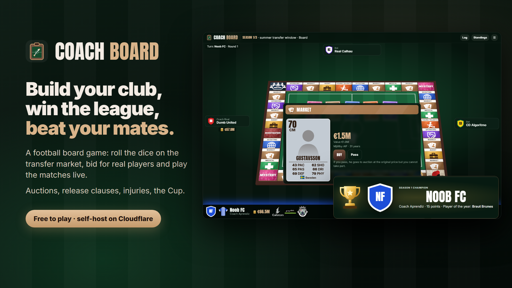
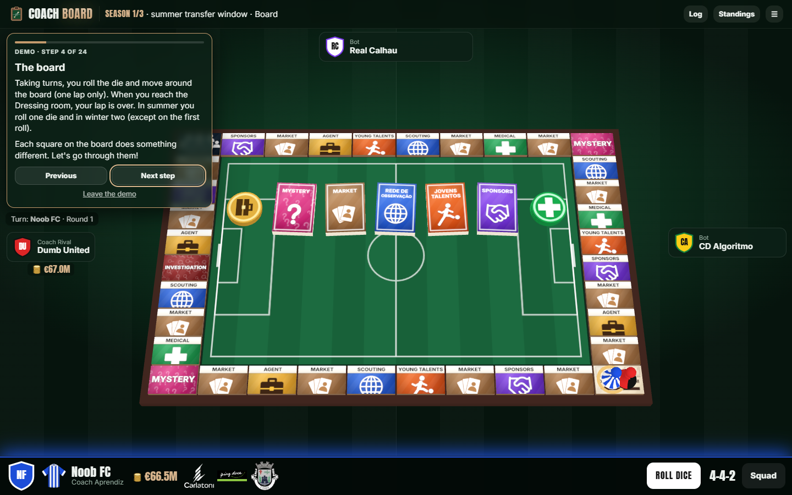
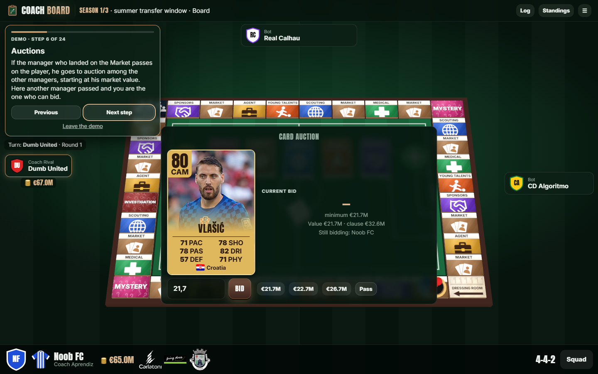
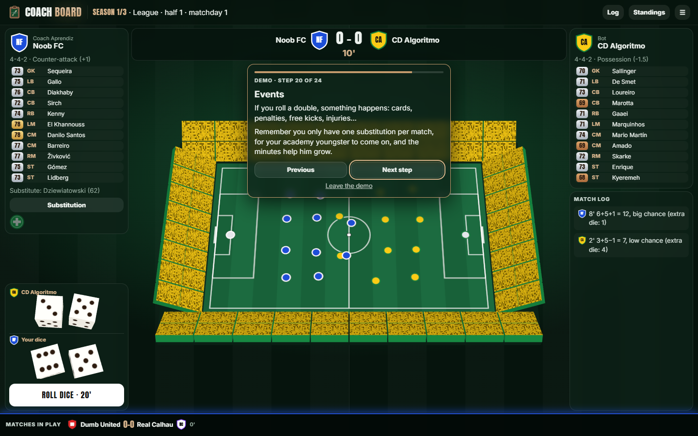
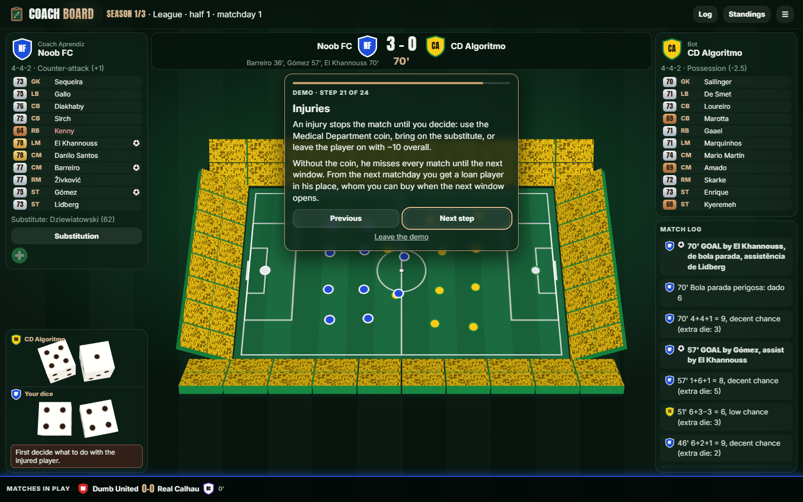
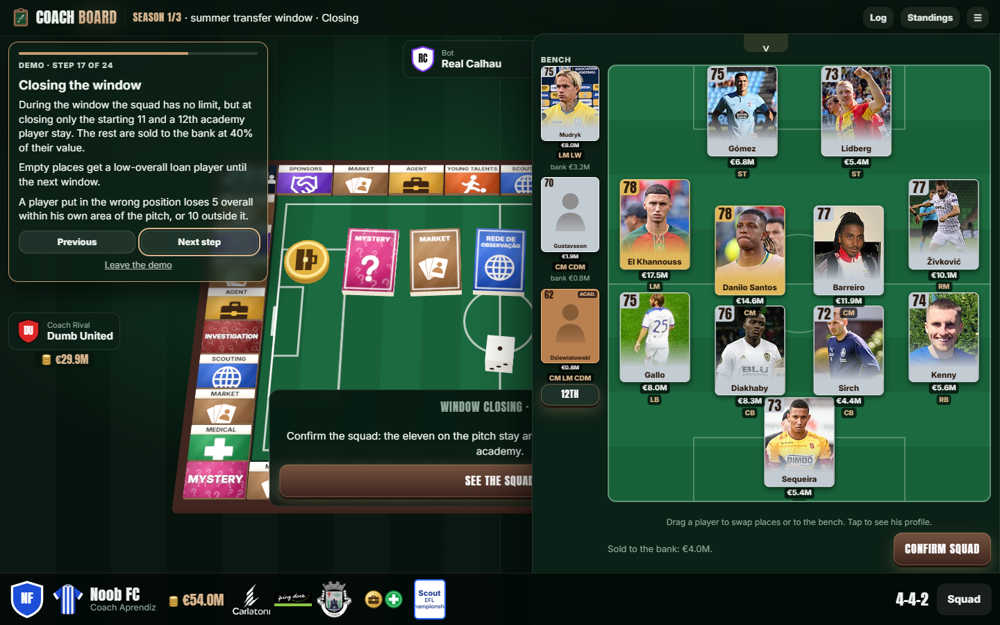
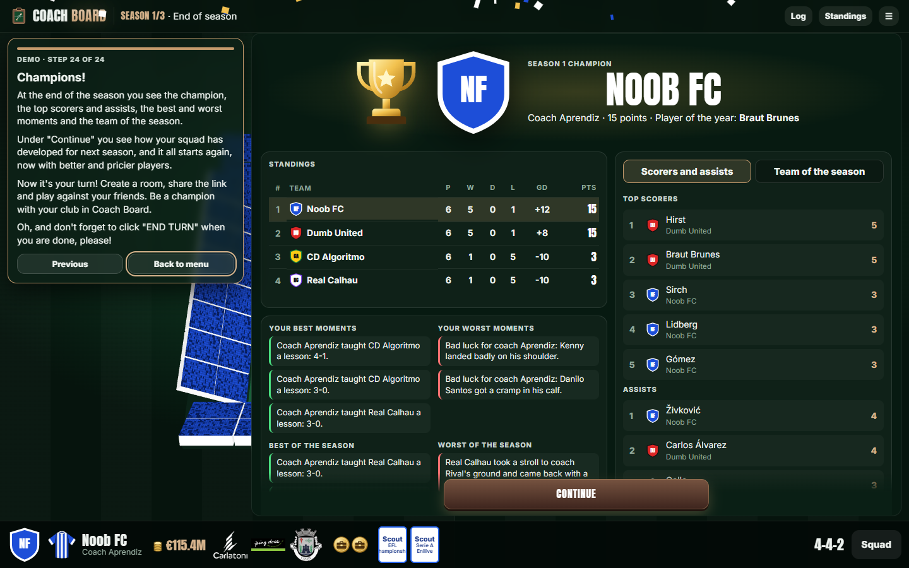
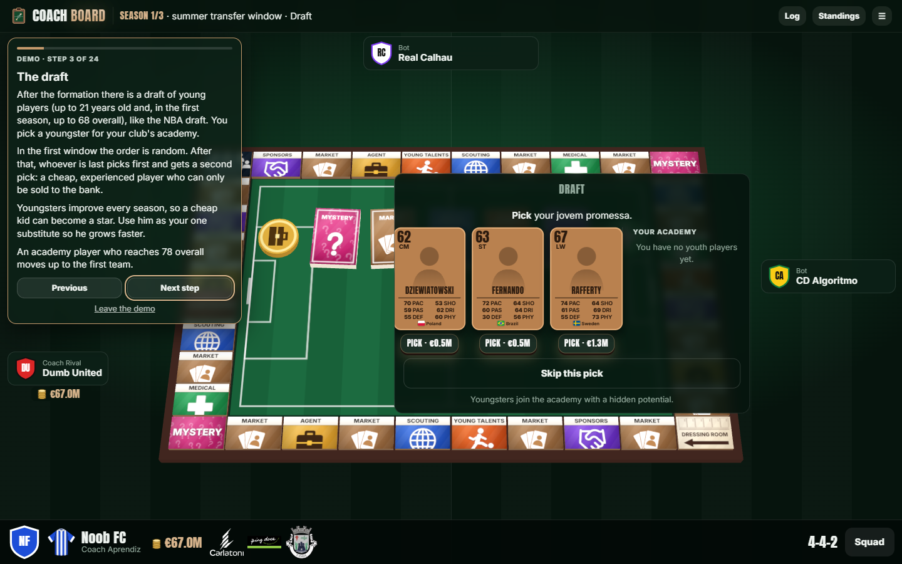
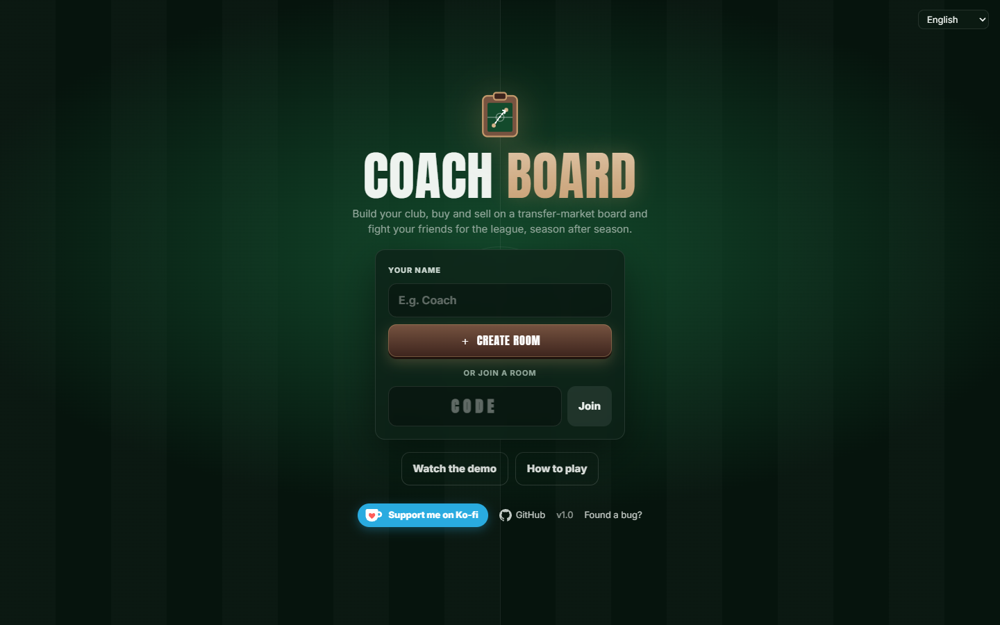

<div align="center">



<a href="https://coach-board.bacoinz.workers.dev"></a>  <a href="LICENSE.md"></a>   

[**▶ Play now**](https://coach-board.bacoinz.workers.dev) · [Watch the demo](https://coach-board.bacoinz.workers.dev/demo?lang=en) · [How to play](#how-to-play) · [Run your own](#run-your-own) · [Report a bug](https://github.com/bacoinz/coach-board/issues/new/choose) · [🇵🇹 Português](README.pt-PT.md)


</div>

> [!TIP]
> **Try it right now:** open **[coach-board.bacoinz.workers.dev](https://coach-board.bacoinz.workers.dev)**, create a room and share the link with your friends. No account, no install. New to the game? The **[guided demo](https://coach-board.bacoinz.workers.dev/demo?lang=en)** walks you through everything.

## Why Coach Board

Football manager games are great alone, but hard to play *with* your mates. Board games are fun with friends, but nobody wants to keep track of transfer fees and league tables on paper.

Coach Board is both: a quick, chaotic board game where everyone is a manager, the transfer market is a board you roll dice around, and the matches are played out live with dice, tactics and the odd ridiculous injury. A match takes from one evening (3 seasons) to a long campaign (10 seasons), and the room saves itself so you can pick it up later.

## Features

**Your club**

- **Create your team:** name, colours, kit (stripes, halves, sash, sleeves…) and a badge from a built-in **badge maker**, or upload your own image.
- **Real players:** about 17,000 players from the current EA SPORTS FC ratings, with photos, positions, nationalities and leagues.
- **A kit brand and two sponsors** (parody brands, with their own logos) that pay signing bonuses and extensions.

**The transfer window**

- **A Monopoly-style board** of 36 squares, played in turns: one lap per window.
- **Market and Young Talents:** a player comes up below his value. Buy him, or pass and he goes to auction.
- **Auctions, bids and release clauses:** bid for any player of another manager. The owner can refuse, unless you meet the release clause.
- **Agents, scouting networks, the medical department, sponsors and board meetings**, each with its own square.
- **Mystery cards** (good and bad) and **investigations** that punish whoever had too much luck.
- **Debt:** you can spend more than you have, but you must end the window in the black, or auction your own players.
- **A draft of youngsters** each window, with a hidden potential, plus a second pick for whoever is last.
- **Squad screen** with drag and drop, a bench, and players out of position (who lose overall).

**The matches**

- **Secret tactic cards** (rock-paper-scissors style), then **dice-driven plays in turns**, shown on a 3D pitch inside a stadium.
- **Strength, tactics and chemistry** change every roll. Doubles bring events: cards, penalties, set pieces and injuries.
- **Injuries stop the match** until you decide: use a medical coin, bring on your sub or leave him on.
- **League, a knockout Cup** in the last seasons, top scorers, a team of the season, and the best and worst moments of each season.
- **Players age, improve, decline and retire.** Youngsters grow with minutes and move up to the first team.

**Everything else**

- **Real-time multiplayer** for 2 to 8 managers, plus bots to fill the league.
- **Rooms save themselves:** close the browser and come back days later with the same link.
- **English and Portuguese**, switchable in the menu.
- **A guided demo** that plays a real match for you, step by step.

## Screenshots

<table>
  <tr>
    <td width="50%"></td>
    <td width="50%"></td>
  </tr>
  <tr>
    <td></td>
    <td></td>
  </tr>
  <tr>
    <td></td>
    <td></td>
  </tr>
  <tr>
    <td></td>
    <td></td>
  </tr>
</table>

<sub>Screenshots taken from the built-in demo.</sub>

## How to play

1. **Create a room** at [coach-board.bacoinz.workers.dev](https://coach-board.bacoinz.workers.dev) and share the link (Discord works great). Everyone sets up their team in the lobby, and the host picks the length (3, 5, 8 or 10 seasons) and the bots.
2. **Each season has two transfer windows** (summer and winter), each followed by half of the league.
3. **In the window**, choose your formation, pick a youngster in the draft, then take turns rolling the die around the board. Each square does something: buy players, get sponsors, agents, scouts, money from the board, or a Mystery card. On your turn you can also bid for other managers' players. Don't forget to press **END TURN**.
4. **At the window closing** you keep your starting 11 and one academy player. The rest are sold to the bank.
5. **In the league**, pick a secret tactic before each match, then roll the dice in turns. Decide what to do when someone gets injured.
6. **At the end**, whoever has the most titles wins (a Cup is worth half a league).

The full rules are in the in-game **How to play** menu and, in Portuguese, in [docs/regras.md](docs/regras.md). The quickest way to learn is the [guided demo](https://coach-board.bacoinz.workers.dev/demo?lang=en).

## Run your own

You need Node 22+ and, to put it online, a free Cloudflare account. It takes about 10 minutes, and there is nothing to configure: no database, no secrets.

```bash
git clone https://github.com/bacoinz/coach-board && cd coach-board/jogo
npm install
npm run dev
```

The game runs at `http://localhost:8787`. Open it in two browser windows (or a normal and a private one) to play against yourself.

**Putting it online:**

1. Log in to Cloudflare from the terminal: `npx wrangler login`.
2. Optional: change the Worker name in `jogo/wrangler.jsonc` (`"name"`), which becomes your address: `https://<name>.<your-subdomain>.workers.dev`.
3. Deploy: `npm run deploy`.

That's it: share the address with your friends. The first deploy creates the Durable Object that stores the rooms.

**Tuning the game:** every balance value (budgets, prices, TV money, injuries, the board, the cards…) is in [`jogo/src/config.js`](jogo/src/config.js). Change it, run `npm test`, and `npm run simular` to see how money and squads evolve over whole simulated matches.

## What it costs

Nothing, on Cloudflare's free plans. Each room is one Durable Object (SQLite storage), and the game sends small messages over a WebSocket that hibernates while nobody plays.

| Service | Free plan | What it means here |
|---|---|---|
| Workers | 100,000 requests/day | Pages, assets and actions for many matches a day |
| Durable Objects (SQLite) | Free tier included | One per room; rooms delete themselves after 120 days without activity |

## How it works

| Part | What it uses |
|---|---|
| Server | **Cloudflare Workers** + one **Durable Object** per room (WebSockets with hibernation, SQLite storage) |
| Game engine | Plain JavaScript in `jogo/src/motor/`, pure functions shared by the server and the tests |
| Interface | Plain HTML, CSS and JavaScript modules, no framework |
| 3D board and stadium | **Three.js** |
| Player data | EA SPORTS FC ratings, packed into a 700 KB file |

- **Few dependencies:** Three.js in the browser, and only Wrangler, Vitest and the flag icons for development.
- **The server is authoritative:** the browser only sends intentions, and the engine checks every rule.
- **Translations:** the interface is written in Portuguese, and [`jogo/public/js/ingles.js`](jogo/public/js/ingles.js) holds the English for every text, including the server's messages.
- **Tests:** about 190, with Vitest. They cover the engine, the economy, auctions, debt, the matches, the end of season, the demo, and whole random matches played to the end.

```
jogo/src/            Worker and Durable Object (the room)
jogo/src/motor/      Game engine: board, market, auctions, matches, league, end of season
jogo/src/config.js   Every balance value in one place
jogo/public/         Interface, 3D board, translations, player data
jogo/scripts/        Data import, simulations, demo, screenshots
jogo/test/           Tests (Vitest)
assets/              Logos of the brands and sponsors
docs/                Rules, data notes and balance reports (Portuguese)
```

Useful commands, inside `jogo/`: `npm run dev`, `npm test`, `npm run simular`, `npm run deploy`.

## Found a bug?

This is version **1.0**, and there will be bugs. If you find one, please **[open an issue](https://github.com/bacoinz/coach-board/issues/new/choose)** saying what you did, what happened and, if you can, a screenshot. Ideas and balance feedback are welcome too.

## Support

Coach Board is free and has no ads. If you enjoyed it, you can buy me a coffee:

<a href="https://ko-fi.com/bacoinz"></a>

## Credits

- Player ratings: [EA SPORTS FC 27 Player Ratings](https://www.kaggle.com/datasets/mikedpad/ea-sports-fc27-player-ratings) (Kaggle). Photos: [Wikimedia Commons](https://commons.wikimedia.org), with the credits in [`jogo/public/LICENCAS.txt`](jogo/public/LICENCAS.txt).
- Coach Board is a fan-made game, not affiliated with EA SPORTS, the clubs or the leagues. The brands and sponsors in the game are parodies.

## License

[PolyForm Noncommercial 1.0.0](LICENSE.md). Free of charge, you can use it, change it and host it for yourself and your friends, a school or a non-profit. Selling it, or selling access to it as a service, is not allowed. For anything commercial, ask the author.
