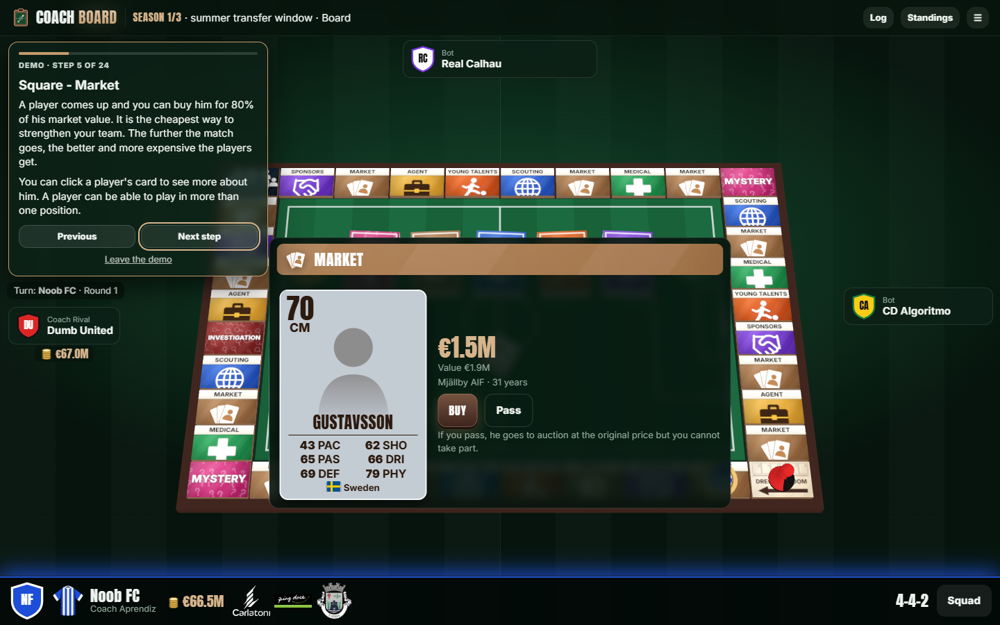
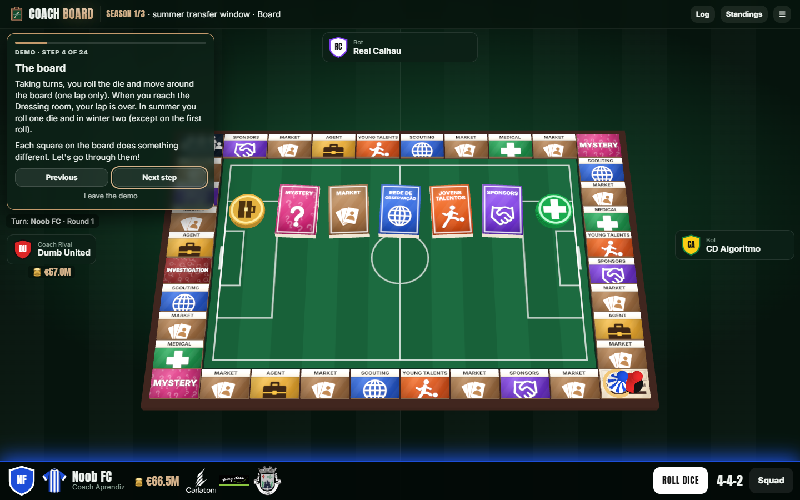
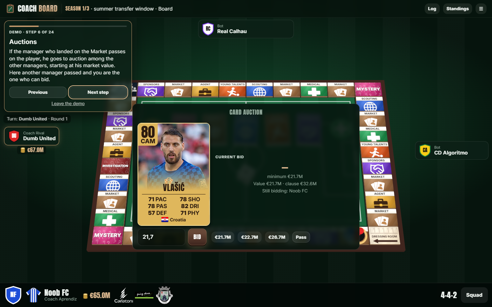
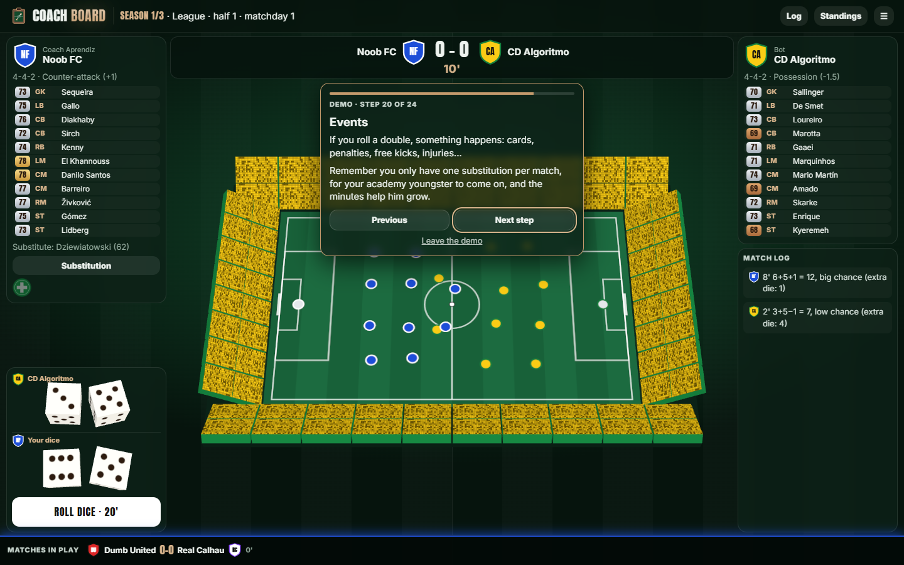
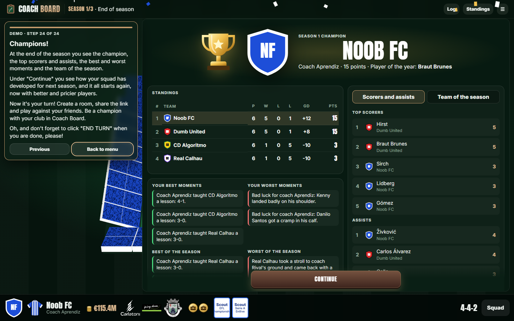

<div align="center">


# Coach Board

**Um jogo de tabuleiro de futebol multijogador: cria o teu clube, joga o mercado de transferências e ganha a liga aos teus amigos.**<br>
Jogadores reais, um tabuleiro de mercado ao estilo Monopólio e jogos decididos aos dados, época após época. Aloja-se de graça na Cloudflare.

<a href="https://coach-board.bacoinz.workers.dev"></a>  <a href="LICENSE.md"></a>  

[**▶ Jogar agora**](https://coach-board.bacoinz.workers.dev) · [Ver a demo](https://coach-board.bacoinz.workers.dev/demo?lang=pt) · [Como jogar](#como-jogar) · [Alojar o teu](#alojar-o-teu) · [Reportar um bug](https://github.com/bacoinz/coach-board/issues/new/choose) · [🇬🇧 English](README.md)



</div>

> [!TIP]
> **Experimenta já:** abre **[coach-board.bacoinz.workers.dev](https://coach-board.bacoinz.workers.dev)**, cria uma sala e partilha o link com os teus amigos. Sem conta e sem instalar nada. Primeira vez? A **[demo guiada](https://coach-board.bacoinz.workers.dev/demo?lang=pt)** explica tudo, passo a passo.

## O que é

Cada um é o treinador de uma equipa. Nas janelas de transferências joga-se um tabuleiro ao estilo Monopólio, à vez, a comprar jogadores no Mercado, em leilões e com Agentes, a assinar patrocínios e a fugir às investigações. Depois joga-se o campeonato: cada jogo decide-se com cartas de tática secretas e lances aos dados, num estádio em 3D. Uma partida vai de uma noite (3 épocas) a uma campanha longa (10 épocas), e a sala guarda-se sozinha para continuar mais tarde.

## Funcionalidades

- **O teu clube:** nome, cores, equipamento e emblema (com um criador de emblemas ou uma imagem tua), uma marca e dois patrocinadores.
- **Jogadores reais:** cerca de 17 000, com os ratings atuais do EA SPORTS FC, fotos, posições, nacionalidades e ligas.
- **A janela de transferências:** tabuleiro de 36 casas, Mercado e Jovens Talentos, leilões, propostas e cláusulas, Agentes, Redes de observação, Departamento médico, Reunião com a SAD, cartas Mistério, Investigação, saldo negativo e draft de jovens.
- **O plantel:** arrastar e largar, banco ao lado do campo e jogadores fora de posição (que perdem overall).
- **Os jogos:** táticas em segredo, lances aos dados à vez num relvado 3D, força, química, acontecimentos, lesões com decisão e substituições.
- **As épocas:** liga, Taça a eliminar nas últimas épocas, marcadores, equipa da época, melhores e piores momentos, jogadores que envelhecem, evoluem e se reformam.
- **Multijogador em tempo real** de 2 a 8 treinadores, com bots para completar a liga.
- **Salas que se guardam sozinhas:** fecha o browser e volta dias depois pelo mesmo link.
- **Português e inglês**, a mudar no menu.
- **Uma demo guiada** que joga uma partida a sério por ti, passo a passo.

## Imagens

<table>
  <tr>
    <td width="50%"></td>
    <td width="50%"></td>
  </tr>
  <tr>
    <td></td>
    <td></td>
  </tr>
</table>

<sub>Imagens da demo, em inglês. No jogo, escolhe o idioma no menu.</sub>

## Como jogar

1. **Cria uma sala** em [coach-board.bacoinz.workers.dev](https://coach-board.bacoinz.workers.dev) e partilha o link (no Discord funciona bem). Cada um prepara a equipa na sala, e o anfitrião escolhe a duração (3, 5, 8 ou 10 épocas) e os bots.
2. **Cada época tem duas janelas de transferências** (verão e inverno), cada uma seguida de meio campeonato.
3. **Na janela**, escolhe a formação, escolhe um jovem no draft e, à vez, lança o dado no tabuleiro. Cada casa faz uma coisa diferente. Na tua vez também podes fazer propostas pelos jogadores dos outros. Não te esqueças de carregar em **TERMINAR A VEZ**.
4. **No fecho da janela** ficas com os 11 titulares e um jogador da formação. O resto é vendido à banca.
5. **No campeonato**, escolhe uma tática em segredo antes de cada jogo e lança os dados à vez. Decide o que fazer quando alguém se lesiona.
6. **No fim**, ganha quem tiver mais títulos (uma Taça vale meio campeonato).

As regras completas estão em [docs/regras.md](docs/regras.md) e no menu **Como jogar** do jogo.

## Alojar o teu

Precisas do Node 22 ou mais recente e, para pôr online, de uma conta gratuita na Cloudflare. Demora uns 10 minutos e não há nada para configurar: nem base de dados, nem segredos.

```bash
git clone https://github.com/bacoinz/coach-board && cd coach-board/jogo
npm install
npm run dev
```

O jogo fica em `http://localhost:8787`. Abre-o em duas janelas do browser (uma normal e uma privada) para jogares contra ti próprio.

**Pôr online:**

1. Entra na Cloudflare pelo terminal: `npx wrangler login`.
2. Opcional: muda o nome do Worker em `jogo/wrangler.jsonc` (`"name"`), que passa a ser o teu endereço: `https://<nome>.<o-teu-subdomínio>.workers.dev`.
3. Publica: `npm run deploy`.

E pronto: partilha o endereço com os teus amigos.

**Afinar o jogo:** todos os valores de equilíbrio (orçamentos, preços, TV, lesões, o tabuleiro, as cartas…) estão em [`jogo/src/config.js`](jogo/src/config.js). Muda-os, corre `npm test` e `npm run simular`, que mostra como evoluem o dinheiro e os plantéis em partidas simuladas.

**Mais documentação:** [regras](docs/regras.md), [tema visual](docs/tema.md), [dados dos jogadores](docs/dados.md) e [equilíbrio](docs/equilibrio.md).

## Encontraste um bug?

Esta é a versão **1.0**, e vai haver bugs. Se encontrares um, **[abre um issue](https://github.com/bacoinz/coach-board/issues/new/choose)** a dizer o que fizeste, o que aconteceu e, se puderes, com uma imagem. Ideias e opiniões sobre o equilíbrio também são bem-vindas.

## Apoiar

O Coach Board é gratuito e não tem anúncios. Se gostaste, podes oferecer-me um café:

<a href="https://ko-fi.com/bacoinz"></a>

## Créditos

- Ratings dos jogadores: [EA SPORTS FC 27 Player Ratings](https://www.kaggle.com/datasets/mikedpad/ea-sports-fc27-player-ratings) (Kaggle). Fotos: [Wikimedia Commons](https://commons.wikimedia.org), com os créditos em [`jogo/public/LICENCAS.txt`](jogo/public/LICENCAS.txt).
- O Coach Board é um jogo de fã, sem ligação à EA SPORTS, aos clubes ou às ligas. As marcas e os patrocinadores do jogo são paródias.

## Licença

[PolyForm Noncommercial 1.0.0](LICENSE.md). De graça, podes usá-lo, alterá-lo e alojá-lo para ti e para os teus amigos, uma escola ou uma associação sem fins lucrativos. Vendê-lo, ou vender o acesso a ele como serviço, não é permitido. Para qualquer uso comercial, fala com o autor.
